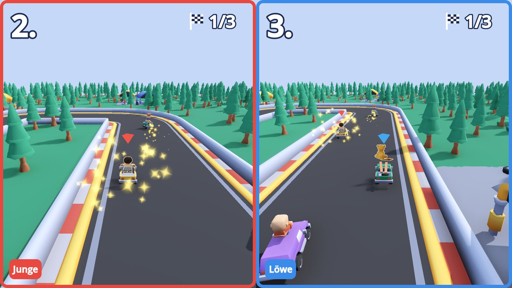

# Handover

Updated 21 Nov 2026, end of the milestone 1 session (Fable 5.2).

## Where it stands

Milestone 1 is built. All local checks pass and the Windows game is exported to
`builds/ToyKart.exe`. **Not yet done: a real race on the projector with two real controllers.**
No gamepad was plugged in during the build, so pads were tested with simulated button presses only.
The couch test below is the gate for milestone 1.

## How you start it

| You want to | Do this |
| --- | --- |
| Play | Double-click **Toy Racer spielen** on the desktop |
| Open the project in Godot | Double-click **Toy Racer in Godot** on the desktop, then press F5 to play |
| Leave a race | Start button on a pad, or Esc: Pause, then **Menü** |
| Leave the game | **Ende** on the first menu page |
| Window instead of full screen | F11 |

## Controls

| | Kind (kid mode) | Profi (full mode) |
| --- | --- | --- |
| Steer | Either stick, D-pad, or LB / RB | Left stick or D-pad |
| Gas | Automatic | RT or A |
| Brake, reverse | Not needed | LT or B |
| Drift | No | Hold RB in a curve; after 1 s you get a small boost when you let go |
| Star (boost) | Fires by itself | X or LB |
| Horn | Any of A, B, X, Y | Y |
| Keyboard 1 | A / D steer, other keys honk | W gas, S brake, A / D steer, Space drift, E star, Q horn |
| Keyboard 2 | Arrow keys | Arrows, `.` drift, Enter star, `,` horn |

In kid mode the stick moves the kart to the left or right side of the road. The kart follows the
road by itself, slows for tight corners, and cannot hit the walls hard or turn around.

## What works

- Menu without reading: mode (Freie Fahrt, Rennen, Zeitfahren), Tempo (Kind, Normal, Schnell),
  Gegner (0 to 3), then "press a button to join". Options and picks are remembered.
- Player selection: each player picks driver, vehicle, Kind or Profi, and colour with their own
  controller, with a live 3D preview. A controller keeps its colour.
- 15 drivers: your 7 toys as paper cut-outs (Junge, Katze, Löwe, Bär, Polizei, Motorrad, Flieger)
  and 8 animated Kenney characters. 5 vehicles (4 trucks, 1 motorcycle).
- One track from Kenney tiles, 40 tiles, 284 m, 3 laps: about 1:45 at Kid speed.
- Race with 1 or 2 players and 0 to 3 AI karts; split screen side by side with a coloured frame
  per player; the Kind player gets the left half.
- Kid mode: auto-accelerate, lane steering, soft walls, pickups fire alone, catch-up boost when
  behind the other human, reset when stuck or off course, calm camera, no clock.
- AI karts stay close to the slowest human when a kid is racing.
- Boost stars with sound and sparkles; horn; countdown; "Letzte Runde!"; pause menu.
- Finish screen with confetti and applause for everyone, places shown small, Nochmal / Menü.
- Time trial with best time per speed.
- Frame rate: about 590 fps average at 1080p split screen with 5 karts on the RTX 4070 (target 60).

## Checked automatically (all passing)

`tools\check.ps1`: no Godot 3 names; every script, scene and resource loads; simulated gamepad
mapping (30 checks); 7 headless runs of the race scene, including two kid karts with nobody
touching the controls, with the stick held to one side, and with random button mashing. At Kid
speed no kart needs a rescue. `tools\export.ps1`: the exe runs a full 2-player kid race with 3 AI
karts and opens its window.

## Not verified, or known weak spots

- Real controllers, the projector, and how the driving feels in your hands. I can read numbers
  and screenshots, not feel.
- Sound levels: all sounds are generated and were never listened to. Expect to want changes.
- The bear's front picture lost its hair (book page with a busy background). A photo on a plain
  background fixes it.
- Vehicles are the kit's trucks, not karts.
- Player selection works with pads and keyboard only, not the mouse.
- Full mode drift and the Fast speed were tuned by the AI driver only.

## The 5-minute couch test

Plug in both controllers first. Sit so that he is on the left.

1. **Minute 1, free drive, him alone.** Freie Fahrt, Weiter. He presses any button on his pad,
   leave "Kind", press A. Say nothing and watch: does he use the stick or the buttons? Does he find
   the horn? Does he drive into a star?
2. **Minute 2 to 4, one race.** Pause (Start), Menü, Rennen, Tempo "Kind", Gegner 3, Weiter. Both
   press a button. You switch your panel to "Profi", both press A.
   Watch: does he look at his own half? What does he do when a kart passes him? Does he notice
   that he cannot crash?
3. **Minute 5, the finish.** Let him press the button on the finish screen himself.
   Does he pick Nochmal?

Write down, right after:

| Question | Answer |
| --- | --- |
| Stick or buttons? | |
| Did he look at his half? | |
| Did he ask for another race? | |
| What made him laugh? | |
| Where did he give up or get bored? | |
| What felt wrong for you in Profi mode? | |
| Too loud, too quiet, annoying sounds? | |

Tell Claude the answers by voice; they become the tuning list.

## What is next

1. Tuning from the couch test (kid mode first, then sound levels, then your Profi feel).
2. Milestone 2 per PLAN.md: more of your toys (retake the bear), music and sound, graphics presets.
3. Two small open decisions from PLAN.md: which small pad, and the first cast for 3D toys.

## Notes for the next Claude session

- Read CLAUDE.md first. The Godot MCP server is configured in `.mcp.json` and loads at session
  start; this session used the Godot command line instead.
- Tuning knobs are listed in CLAUDE.md under "Common jobs".
- Screenshots need a visible window: a covered or minimised window returns a stale picture.
- Leak notices when Godot quits (`resources still in use at exit`) come from sounds still
  playing; they are not script errors and the checks ignore them.
- `tools/.venv` and `tools/.cache` (1.1 GB of cut-out models) are not in git. Recreate with
  `python -m uv venv tools/.venv --python 3.12` and `uv pip install "rembg[cpu]" pillow numpy`.
