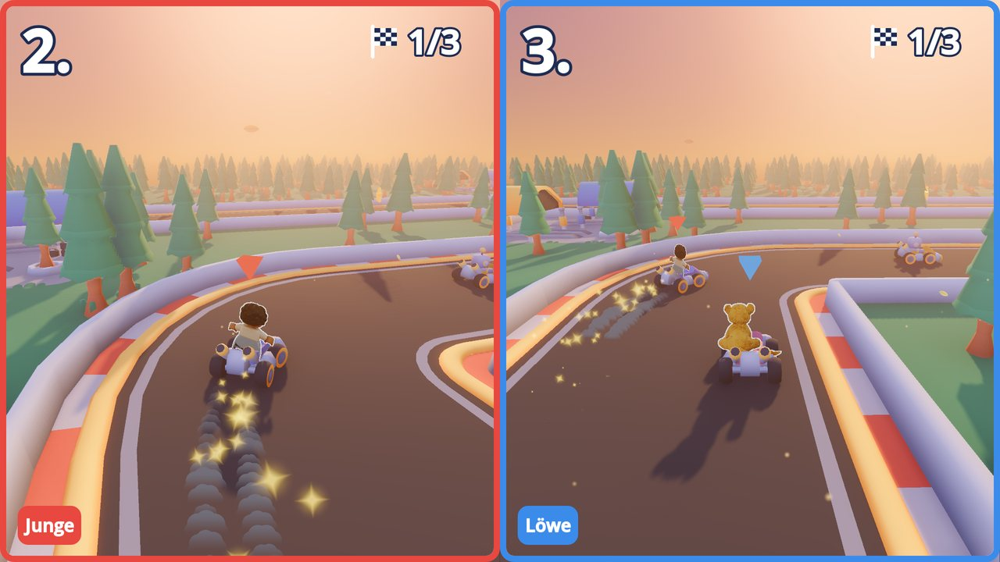
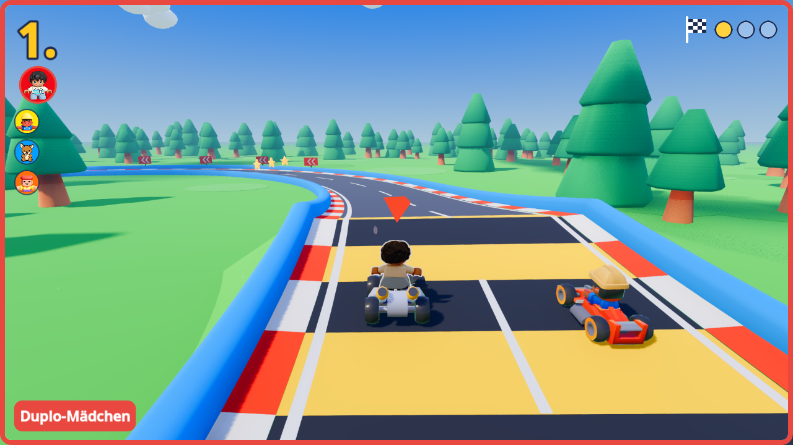
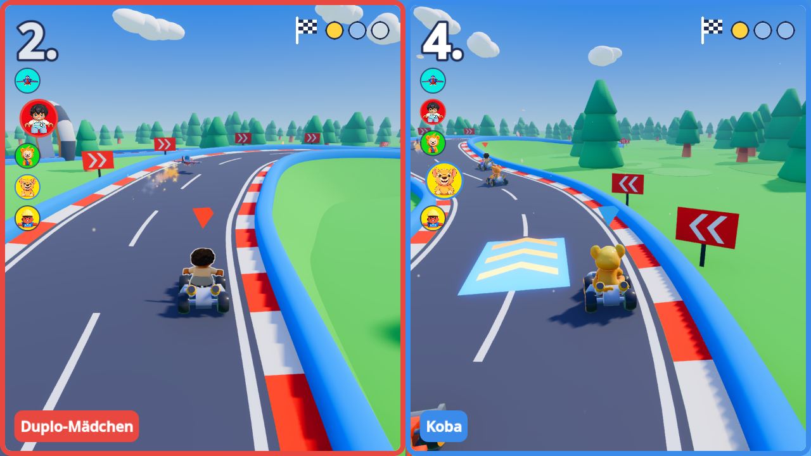
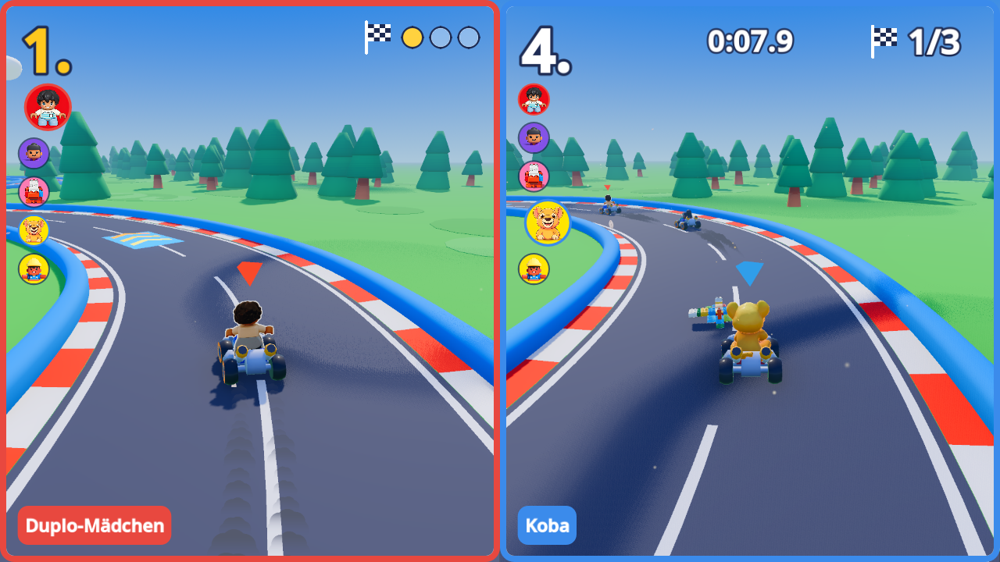

# Handover

Updated 23 Nov 2026, twelfth round: hills, a jump with tricks, and arrow boards (roadmap phase B).

## Where it stands

Milestone 1 is built. All local checks pass and the Windows game is exported to
`builds/ToyKart.exe`. **Not yet done: a real race on the projector with two real controllers.**
No gamepad was plugged in during the build, so pads were tested with simulated button presses only.
The couch test below is the gate for milestone 1.

## New in the twelfth round (phase B: tracks with moments)

- **Hills:** Kurvenkurs has one (2.2 m), Riesenrunde two (2.6 m and 1.8 m). The road stands on
  grass embankments. Karts get an arcade hill assist (80 % of the pull along a slope is
  cancelled), so nobody stalls uphill or runs away downhill.
- **A jump on the home straight** of both round tracks: a yellow-black striped ramp, 1.3 m high,
  and a long downhill landing that catches every kart at every speed.
- **Tricks:** in the air, press drift, item or horn and the kart spins once; landing gives a short
  boost. In kid mode (and for the AI) the trick happens by itself.
- **Arrow boards:** red boards with white arrows on the outside of tight corners (22 on
  Kurvenkurs, 32 on Riesenrunde).
- **Road collision from the road itself:** a road floor built from the same data as the road
  mesh (hills and ramp), so the generator stays the only source.
- **Banked corners: tried and switched off.** With the road tilted, the rolling-ball karts slid
  out of corners and spun. The code is in the generator (`MAX_BANK`, set to 0); it needs kart
  physics work first (ROADMAP phase B).
- Turbo pads glow a little less (they looked pale).
- Waldkurs (Kenney tiles) is unchanged: still flat.
- Tests: all kid races still at zero resets and zero wall hits.

## New in the eleventh round (research, roadmap, quick wins)

- **Research and roadmap:** `docs/RESEARCH.md` ranks 39 ideas from five research passes (feel,
  gameplay and kid design, Godot tech, tracks, code audit; notes in `docs/research/`).
  `docs/ROADMAP.md` orders them in phases A to G with your answers (his delight first, friendly
  items, build for 2, both screens, no playtest gate). Phase A is done except the items below.
- **After his first 2 minutes (autopilot too strong, too slow, not flashy enough):**
  Kid speed 0.78 -> 0.92, cruise 85 -> 90 %, the helping hand in the middle of the road
  30 -> 15 %, the stick reaches the wheels 55 -> 80 %. Tests: hands off = 3rd, steering well = 1st,
  still no wall hits and no resets.
- **Drift sparks:** blue after 0.5 s, orange after 1 s, purple after 2 s (Profi only), each with a
  ding and a rumble tick; letting go gives a bigger boost per colour. **For him: steering hard in
  the middle of the road charges blue and orange sparks too**, letting go of the stick boosts.
  Near the edge the charge is dropped, never fired.
- **Boosts fade out** over 0.8 s instead of stopping hard. **Start boost:** gas held when "Los!"
  comes (kid mode always gets it). **Walls glance off:** only the speed into the wall is lost and
  the nose turns along the wall. **Bumping is fun:** you two touching gives both a small boost;
  his kart is hardly pushed.
- **Controller rumble** on boosts, sparks, walls and bumps (softer for him). "Rütteln an / aus"
  on the options page.
- **Toy look:** rim light on karts and drivers, clear-coat shine on karts, glowing stars,
  pulsing turbo pads.
- **HUD he can read:** the place digit is gold, silver or bronze, a column of faces shows the race
  order (your own face big), and in kid mode the laps are dots.
- **Tech:** MSAA 4x plus SMAA in split screen, 2 shadow splits in split screen (split screen went
  from 140 to 162 fps on the RTX 4070), exclusive fullscreen for 144 Hz, shader baker on in export.

- **Not checked yet:** a real pad's rumble strength (no pad was connected), and the look on the
  projector.

## New in the tenth round (faces and colours)

- **Driver faces in the menu:** each driver has a portrait drawn locally by FLUX.2 (from the toy
  drawings and photo cut-outs; the Kenney characters from a front render). The driver row shows
  the chosen face big and the faces before and after it small, so a child can pick by face.
  `tools/make_portraits.py` makes two variants per driver and installs the chosen ones.
  The kart preview above is zoomed in to make room (the kart looks bigger now).
- **Stronger colours, toy-brick style:** the four Kenney colour palettes (karts, characters, track
  pieces, trees) are more saturated (`tools/make_strong_colors.py`; greys, whites and skin barely
  change; originals in `art/kenney_colors/`, `--strength 0` restores them). Round tracks: green
  grass, blue barriers, red kerbs. Turbo pads were washed out (colours read as linear); now
  strong blue and yellow. Light: AgX contrast up, saturation up, less haze in the evening.
  Johannes' own toys are unchanged except for that light.
- Global skill `local-game-assets` with all asset lessons, usable in every project.

## New in the ninth round (the 3D cast)

- **3D now:** fox, police motorbike, police car (from Codex views), plus Koba, Bobo, plane and the
  Duplo plane. Only the Duplo girl is still a card. Cars and bikes are sized nose to tail like a
  kart (`--length`). The colour match only brightens now (it darkened the motorbike before).
- **Bobo smiles:** a FLUX.2 edit of Codex's front view (original kept in
  `art/toys/turnaround/originals/`), then a new 3D run.
- **FLUX.2 turnaround sheets do not work** (side views come out as three-quarter back views);
  Codex keeps that job. FLUX is for portraits, textures and small edits.
- Known: the police car's "POLICE" lettering is a little scrambled (AI texture).

## New in the eighth round (Bobo and plane in 3D, local pictures)

- **Bobo and the plane are 3D**, made from Codex's turnaround views with one command each
  (8 and 5 minutes). Colours are matched to the drawings (Pixal3D textures come out darker).
  The plane flies a little above the road, like its card did.
- **FLUX.2 [klein] 4B** runs locally (`tools/comfy/run_flux_klein.py`, Apache 2.0): great for
  portraits and textures; exact matching views stay with Codex. A Bobo portrait is in
  `art/toys/portraits/` (not used in the game yet).
- Next 3D toy: the police car (Codex turnaround views first).

## New in the seventh round (3D toys, part 2)

- **Koba brighter:** matte plush material (no baked shadow map), darker patches lifted toward his
  main yellow. Face shape unchanged: better input views (Codex turnarounds) or a hand edit in
  `art/models/loewe_edit.blend` are the ways to improve it.
- **Duplo-Flieger in 3D, built in Blender without AI:** brick by brick after the photos, with
  studs, slopes, wheels and the two leaf pieces. It is now a toy vehicle (replaces the kart).
- **One command per toy:** `tools/make_3d_toy.py --id <id> --apply` (Codex views -> Pixal3D ->
  Blender -> game). `check_art.py` checks turnaround sets. Codex prompt: `docs/CODEX_TURNAROUND.md`
  (Bobo, then the plane, then the police car).
- **ComfyUI for you:** desktop shortcut "ComfyUI (3D-Modelle)"; steps in `docs/MODELS_3D.md`.
- Backlog: toys only in fitting karts (your idea).

## New in the sixth round (Koba in 3D)

- **Koba is 3D:** a real 3D lion in the kart instead of the card, with ears, back and tail
  visible from the chase camera. Made from four views (front, both sides, back) taken from your
  Tripo screen recording, turned into a model by Pixal3D on this PC (9 minutes on the RTX 4070),
  then cleaned and sized in Blender.
- **New local tools (no account, nothing uploaded):** ComfyUI with Pixal3D in
  `C:\Users\Johannes\AI projects Local\ComfyUI` (about 20 GB with models), and
  `tools/comfy/run_pixal3d.py`. Tripo dropped: its free plan has no downloads (decision updated).
- Not checked yet: Koba from the front in the menu preview, and on the projector.

## New in the fifth round (your feedback on boosts, first drawings, 3D start)

- **Boosts toned down:** you were boosted almost all the time on Kurvenkurs. Measured: 40 to 85 %
  of the race. Now about half the stars and turbo arrows on every track, and shorter boosts
  (star 1.3 s, arrows 0.8 s, the push itself unchanged). A normal racer is now boosted 5 to 15 %
  of the race, a very good driver who hunts every star about 25 %. The smoke races print
  `boosted=..%` per kart, so this stays measurable.
- **Codex drawings in the game:** Koba, Bobo, Polizei and Flieger use the drawn pictures
  (Codex commit 080a1b3). Fuchs, Duplo-Mädchen, Motorrad and Duplo-Flieger still use photos.
- **3D toys, step one:** `tools/blender/prepare_toy_model.py` turns a Tripo download into a game
  model (clean, shrink to 12k triangles, size, face forward, check sheet). Tested end to end with a
  stand-in model. Waiting for the Koba model from Tripo; steps in `docs/MODELS_3D.md`.

## New in the fourth round (milestone 2 starts)

- **Who sits where:** the empty panels are now "Linke Seite" and "Rechte Seite". Press left on
  your stick or keys to sit left, right to sit right (the join button still takes the first free
  seat). The panel header says "Links" or "Rechts". If the Kind player sits right and the Profi
  left, the panels swap at once, so you see the real seats before the race.
- **Boosts you feel and see:** stars and turbo arrows push the kart forward (+40 % for 1.6 s,
  arrows +30 % for 1 s) instead of the old barely noticeable change. While boosting: an orange
  flame trail, white speed streaks on the screen, and a wider camera view (also in kid mode,
  a little calmer). Tested: hands-off kid still 4th, good driving still wins.
- **Music:** a calm menu tune and an upbeat race tune that starts with "Los!" and speeds up on the
  last lap. Generated on this PC (`tools/make_music.py`), no licences. "Musik an / aus" on the
  options page.
- **Sound:** separate channels for music, effects and engines (music a bit quieter, engines a bit
  quieter than effects; quieter again in split screen). A rumble when you drive on the kerb,
  a zip on the turbo arrows, and every driver honks a little differently.
- **Drawn toys, prepared for Codex:** put drawings in `art/toys/` and the game uses them instead
  of the photos. The brief is `docs/ART_BRIEF.md`, the prompt to paste into Codex is
  `docs/CODEX_TOY_ART.md`.
- **Plan:** milestone 1 passed on your test drive. Your test drives are the gates until he is
  ready; the second controller and his couch test are milestone 5.

## New in the third round (after your first test drive)

- **Kid mode is no longer automatic.** In the middle of the road the stick really steers. A
  helper only takes over near the edge, and the edge strip slows the kart. Without gas the kart
  cruises at 85 %; **A or RT (W / arrow up on a keyboard) = full speed.** B, X, Y honk.
  In tests: hands off = 3rd to 5th place, only gas = 3rd, steering well with gas = 1st.
  Still no wall hits and no resets.
- **AI with a kid:** two AI karts stay a little ahead, one behind, but never drive faster than
  normal to keep their spot, so a kid who drives well passes them.
- **Profi:** a leading AI eases off from 8 m ahead; whoever is behind the leading AI gets up to
  12 % extra top speed. **Schnell is faster** (1.5 instead of 1.3), Normal slightly (1.05),
  Kind slightly (0.78) to make up for the cruise speed.
- **Player menu:** an empty panel shows how to join (Controller: A, W A S D: Leertaste,
  Pfeile: Enter). A joined panel shows what Kind / Profi means, the driving keys for that
  device, and how to move and leave. The keys also show at the bottom of the screen for the
  first seconds of a race.
- **Toy vehicles:** Motorrad, Polizei and Flieger are now the vehicle themselves (the plane
  flies a bit above the road). The vehicle row then says "fährt selbst". The Duplo-Flieger still
  sits in a kart; say if it should be a vehicle too (one line in its file).
- **Names:** Katze is now **Fuchs**, Löwe is **Koba**, Junge is **Duplo-Mädchen**, Bär is **Bobo**.
- **New long track "Riesenrunde":** 716 m with an S, a wide hairpin and a long home straight,
  2 laps (about 3 minutes at Kind speed).
- **Turbo arrows:** blue pads with yellow arrows on all three tracks; drive over them for a
  short turbo, no button needed. More stars on Waldkurs.

## New in the second round (your four requests)

- **Duplo plane:** in the game as the driver "Duplo-Flieger". All five photos are kept in
  `photos/toys/` (front, back, left, right, top) for a 3D model later.
- **Track with round curves:** "Kurvenkurs", a flowing loop with wide bends, no 90 degree corners.
  It is now the first track. The tile track stays as "Waldkurs". Pick the track on the options
  page; each button shows the track's shape.
- **Karts the toys sit inside:** five little open go-karts, a racing car and an oldtimer. The
  trucks and the motorcycle are still at the end of the list.
- **Light and weather:** warm sun with soft shadows, a sky that lights the shade, haze in the
  distance, bloom, clouds that drift and cast moving shadows, dust glinting in the air.
  Kurvenkurs is a sunny day with petals; Waldkurs is a warm evening with long shadows, light
  shafts between the trees and autumn leaves.

## How you start it

| You want to | Do this |
| --- | --- |
| Play | Double-click **Toy Racer spielen** on the desktop |
| Open the project in Godot | Double-click **Toy Racer in Godot** on the desktop, then press F5 to play |
| Leave a race | Start button on a pad, or Esc: Pause, then **Menü** |
| Leave the game | **Ende** on the first menu page |
| Window instead of full screen | F11 |
| Game opened on the monitor, not the projector | Win + Shift + arrow key moves it to the other screen |

## Controls

| | Kind (kid mode) | Profi (full mode) |
| --- | --- | --- |
| Steer | Either stick, D-pad, or LB / RB | Left stick or D-pad |
| Gas | Cruises by itself; A or RT = full speed | RT or A |
| Brake, reverse | Not needed | LT or B |
| Drift | No | Hold RB in a curve; after 1 s you get a small boost when you let go |
| Star (boost) | Fires by itself | X or LB |
| Horn | B, X or Y | Y |
| Keyboard 1 | A / D steer, W full speed, other keys honk | W gas, S brake, A / D steer, Space drift, E star, Q horn |
| Keyboard 2 | Left / right steer, up full speed | Arrows, `.` drift, Enter star, `,` horn |

In kid mode he steers himself. A helper catches the kart near the edge and steers it back, the
edge strip slows it a little, and it cannot hit the walls hard or turn around.

## What works

- Menu without reading: mode (Freie Fahrt, Rennen, Zeitfahren), Tempo (Kind, Normal, Schnell),
  Gegner (0 to 3), then "press a button to join". Options and picks are remembered.
- Player selection: each player picks driver, vehicle, Kind or Profi, and colour with their own
  controller, with a live 3D preview. A controller keeps its colour.
- 16 drivers: your 8 toys as paper cut-outs (Junge, Katze, Löwe, Bär, Polizei, Motorrad, Flieger,
  Duplo-Flieger) and 8 animated Kenney characters. 12 vehicles: 5 karts, racing car, oldtimer,
  4 trucks, motorcycle.
- Two tracks, each about 285 m and 3 laps (about 1:45 at Kid speed): Kurvenkurs (round curves,
  sunny) and Waldkurs (Kenney tiles, evening).
- Race with 1 or 2 players and 0 to 3 AI karts; split screen side by side with a coloured frame
  per player; the Kind player gets the left half.
- Kid mode: auto-accelerate, lane steering, soft walls, pickups fire alone, catch-up boost when
  behind the other human, reset when stuck or off course, calm camera, no clock.
- AI karts stay close to the slowest human when a kid is racing.
- Boost stars with sound and sparkles; horn; countdown; "Letzte Runde!"; pause menu.
- Finish screen with confetti and applause for everyone, places shown small, Nochmal / Menü.
- Time trial with best time per speed.
- Frame rate at 1080p split screen with 5 karts on the RTX 4070 (target 60): about 450 fps on
  Kurvenkurs and 350 fps on Waldkurs, worst 1 % above 175 fps.

## Checked automatically (all passing)

`tools\check.ps1`: no Godot 3 names; every script, scene and resource loads; simulated gamepad
mapping (30 checks); a scripted walk through the menu with two keyboard players into a race, pause
and resume (22 checks); 9 headless runs of the race scene on both tracks, including two kid karts with nobody
touching the controls, with the stick held to one side, and with random button mashing. At Kid
speed no kart needs a rescue. `tools\export.ps1`: the exe runs a full 2-player kid race with 3 AI
karts and opens its window.

## Not verified, or known weak spots

- Real controllers, the projector, and how the driving feels in your hands. I can read numbers
  and screenshots, not feel.
- Sound levels: all sounds are generated and were never listened to. Expect to want changes.
- Bobo's front picture lost its hair (book page with a busy background). A photo on a plain
  background fixes it: name it `bobo-front.jpg`, or replace the bear photos listed in
  `photos/toys/pairs.json`.
- Kid mode feel: tuned with simulated kids only. Watch whether he finds the gas button and
  whether the edge strip feels like a fair "oops" or like a punishment.
- Toy vehicles are flat photo cards: from the side they look thin. A 3D model fixes that later.
- The new look was judged from still pictures only. Moving clouds, leaves and light shafts may
  feel different in motion; say what is too much.
- The Duplo plane's front photo is a little blurred; a sharper one would look better.
- Player selection works with pads and keyboard only, not the mouse.
- Full mode drift and the Fast speed were tuned by the AI driver only.

## The 5-minute couch test

Plug in both controllers first. Sit so that he is on the left.

1. **Minute 1, free drive, him alone.** Freie Fahrt, Weiter. He presses any button on his pad,
   leave "Kind", press A. Say nothing and watch: does he use the stick or the buttons? Does he find
   the horn? Does he drive into a star?
2. **Minute 2 to 4, one race.** Pause (Start), Menü, Rennen, Tempo "Kind", Gegner 3, Weiter. Both
   press a button. You switch your panel to "Profi", both press A.
   Watch: does he look at his own half? What does he do when a kart passes him? Does he notice
   that he cannot crash?
3. **Minute 5, the finish.** Let him press the button on the finish screen himself.
   Does he pick Nochmal?

Write down, right after:

| Question | Answer |
| --- | --- |
| Stick or buttons? | |
| Did he look at his half? | |
| Did he ask for another race? | |
| What made him laugh? | |
| Where did he give up or get bored? | |
| What felt wrong for you in Profi mode? | |
| Too loud, too quiet, annoying sounds? | |

Tell Claude the answers by voice; they become the tuning list.

## What is next

1. You: a race as Koba and as Duplo-Flieger. Colours, size, does it look like the toy?
2. Claude: the Duplo girl in 3D, built in Blender like the Duplo plane (photos from all sides are
   in `photos/toys/`). She is the last paper card; all 8 toys already have a portrait.
3. You: on the projector, are the colours strong enough now (or too strong)? Can he pick his
   driver by face? Do the boosts feel special, not constant?
4. Rest of milestone 2: graphics presets for projector and monitor, scenery; faces also on the
   HUD and finish podium (backlog).

## Notes for the next Claude session

- Read CLAUDE.md first. The Godot MCP server is configured in `.mcp.json` and loads at session
  start; this session used the Godot command line instead.
- Tuning knobs are listed in CLAUDE.md under "Common jobs".
- Screenshots need a visible window: a covered or minimised window returns a stale picture.
- Leak notices when Godot quits (`resources still in use at exit`) come from sounds still
  playing; they are not script errors and the checks ignore them.
- `tools/.venv` and `tools/.cache` (1.1 GB of cut-out models) are not in git. Recreate with
  `python -m uv venv tools/.venv --python 3.12` and `uv pip install "rembg[cpu]" pillow numpy`.

### Lessons from the art rounds (6 to 10)

- The asset lessons are also in the global skill `local-game-assets` (`~/.claude/skills/`, outside
  the repo, with copies of the reusable scripts) so other games benefit. Add new lessons there too.
- Pick the tool by the job: Codex for four matching views; Pixal3D (local ComfyUI) for round,
  soft toys; Blender from simple shapes for blocky Duplo toys; FLUX.2 klein (local) for
  portraits, textures and small edits of one view. FLUX turnaround sheets fail.
- FLUX follows the reference picture closely. A wrong-looking result usually means the
  reference looks like that (the "fox" is a brown plush). Add a word hint only where the name
  matters (`HINTS` in `make_portraits.py`). Put transparent references on white first.
- ComfyUI scripts use a server that is already running. If Johannes has ComfyUI open and closes
  it, the run dies halfway: rerun only the missing ids.
- FLUX takes about 40 s per 768 px picture on the RTX 4070 (it swaps the text encoder);
  Pixal3D 5 to 10 minutes per model. Run them one after another, never two GPU jobs at once.
- Pixal3D textures come out dark: the colour match only brightens. Vehicles are sized by length.
- Godot: vertex colours need `vertex_color_is_srgb = true`, or they look washed out. AgX at its
  default contrast makes everything pastel. Kenney kits colour everything through one
  `Textures/colormap.png` per kit.
- Never read photos directly: contact sheets are enough to see what is in them. The 37 photos
  in `photos/toys/` show 8 toys; the unlisted ones are side and top views (good references).
