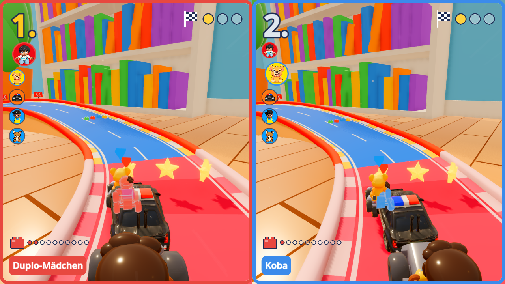

# Roadmap to Mario Kart quality

22 Nov 2026. Built from the ranked research in [RESEARCH.md](RESEARCH.md) (numbers `#n` point to its
list) and Johannes' answers. PLAN.md milestones still apply; this page orders the work inside them.

## Goals (agreed 22 Nov 2026)

- **His delight first, a real race for dad close second.** Two layers: deep for the adult, assisted
  and flashy for the child. Public release stays parked.
- **No playtest gate.** Johannes develops on and plays with him whenever there is time.
- **Order of pillars:** driving feel and juice, then tracks and worlds, then gameplay variety, then
  graphics extras.
- **Items are friendly:** boosts, shield bubble, silly hits that cost no real time. Classic items
  only between adults later, if ever.
- **Build for 2 players, never block 4:** HUD and camera code stay viewport-agnostic.
- **Free and local by default.** Exception: CC0 or cheap recorded sound effects, each purchase
  approved by Johannes.
- **Both screens:** the 1080p projector (steady 60 fps in split screen, readable) and the
  1440p 144 Hz monitor.

### What he showed in his first 2 minutes (22 Nov 2026)

He played the two-button kid mode. The autopilot was too strong, so he felt no feedback from the
car, and the car was very slow. He loves looking at his toys, but it was not bright or flashy
enough. He loves playing together, even on the keyboard. So: faster kid mode, a lighter hand,
much more feedback (sparks, rumble, sounds), brighter and shinier.

## Phase A: quick wins (done 22 Nov 2026, eleventh round)

Open from A: feel the rumble on a real pad and judge the look on the projector. Small add-on for
later: a helper icon that lights up when the kid assist steers (Nintendo's glowing antenna).

| Item | Research |
| --- | --- |
| Kid mode faster, lighter autopilot, more feedback when he steers | his test |
| Drift levels with spark colours, bigger boost per level; kid gets levels 1-2 by himself | #1 |
| Boosts fade out | #2 |
| Controller rumble (soft for kid, off switch) | #3 |
| Start boost that never stalls | #4 |
| Walls glance off | #5 |
| Bumping is fun: small boost for both | #9 |
| Glow and colour re-tune, rim light, shiny pads and stars | #6 |
| Toy materials: plastic with clearcoat, plush | #7 |
| Kid-readable HUD: face + medal colour, lap dots, face strip | #8 |
| MSAA 4x + SMAA, shadow budget in split screen, 144 Hz frame pacing | #10 |

## Phase B: tracks with moments (mostly done 23 Nov 2026, twelfth round)

| Item | Research | Status |
| --- | --- | --- |
| Hills (road floor collider from the road data, embankments, hill assist) | #14 | Done on both round tracks |
| One jump per track, trick boost, guaranteed landing for the kid | #15 | Done on both round tracks |
| Corner arrow boards | research tracks #8 | Done |
| Automatic banking (up to ~9°, from the curvature) | #14 | Done on both round tracks |
| Width per point and corner rhythm in the generator | #21 | Open: needs `Track.half_width` per point through assist, AI and resets |
| One signature moment per track (cushion jump, toy train, tunnel) | #17 | Done for Kurvenkurs (toy train bridge) and Riesenrunde (caterpillar tunnel), see below. Waldkurs and the living-room world open |
| Hills and a jump on Waldkurs | | Open: Kenney tiles have no slope collision |

Signature moments (23 Nov 2026). Generated by `tools/track_moments.gd` from a `"moment"` entry in
`build_round_track.gd`; no collision anywhere, so they can never stop, block or reset a kart.
- **Kurvenkurs, toy train bridge** (s = 68 m): a rail on toy-brick piers 5 m over the road with a
  yellow bow bridge, between two mountains with tunnel portals. `scripts/track/toy_train.gd`: the
  train (engine with a face, three wagons with balls, blocks, a present) waits in a mountain and
  sets off when a player camera is about to reach the bridge, so each player sees it cross;
  alternates direction, whistles twice, chugs, puffs cotton-ball steam.
- **Riesenrunde, caterpillar tunnel** (s = 404-440 m, after the second hill): a rainbow caterpillar
  the road runs through, in at its pink-lipped mouth. `scripts/track/tunnel.gd`: eyes follow the
  nearest camera and blink, antennae wobble, fairy lights twinkle, four warm lamps; inside, each
  camera gets a dimmer copy of the environment and its own engine bus (Engines, or Player1/2 in
  split screen) a light reverb. 7 m high inside, so the chase camera never touches the roof.

## Phase C: playing together (done 23 Nov 2026, thirteenth round)

| Item | Research | Status |
| --- | --- | --- |
| Team mode "us vs. the toys" | #11 | Done: "Team" card, team place, team finish banner |
| Kid-safe items: turbo, superstar, shield bubble, spring, tickle bubble | #12 | Done (magnet left out: too close to turbo) |
| Item odds per player, no blue shell | #13 | Done |
| Bricks on the racing line, dot counter | #18 | Done |
| Podium medals, family brick jar | #16 | Done. A present after every race: done in round 16 (10 stickers that collect on the family's karts) |
| Toy rescuer respawn | #20 | Done: a red toy helicopter lowers the kart on a rope and flies off (the kart can drive at once) |
| Hidden rubber-band: wide lines | #19 | Done; a close pack in the last lap is open |

## Phase D: sound and camera (done 23 Nov 2026, fourteenth round)

| Item | Research | Status |
| --- | --- | --- |
| Engine layers | #22 | Done: recorded engine + generated high whine layer. A full 3-loop RPM engine is open |
| Adaptive music with a final-lap version | #22 | Done: cross-fade into a faster tune |
| Split-screen audio: own engine per half, panned | #23 | Done |
| Spring chase camera with drift swing | #24 | Done |
| Recorded sound effects where generated ones feel cheap (ask before buying) | goals | Waits for Johannes' ears |

## Phase E: worlds (done 23 Nov 2026, fifteenth round)

| Item | Research | Status |
| --- | --- | --- |
| Living-room toy world, his toys as giant landmarks | #25 | Done: track "Wohnzimmer" (sofa with Bobo, coffee table bridge, Koba in the infield, fox by the window, police car on the table, two planes circling) |
| Three zones per lap, each with its own look | #26 | Done: "zones" in the generator (road, kerb, barrier colours); Wohnzimmer has wooden floor, rug, play corner with a brick arch |
| Background life: waving toys, animals, plush crowd | #33 | Done: `ToyMotion` (bob, rock, nod, hop, orbit, blink); fans by the start line and a plane on every round track |
| One safe fork per track | #32 | Done on Wohnzimmer: side lane round a brick island (`Track.forks`); kid assist keeps the main road, some AI take the lane. Other tracks: add a "fork" entry |
| MultiMesh grass with wind, toon water | #35 | Done: grass, flowers, reeds; pond on Kurvenkurs, lake on Riesenrunde |

## Phase F: more to play (done 23 Nov 2026, sixteenth round)

| Item | Research | Status |
| --- | --- | --- |
| Mini-cup of 3 races with a trophy | #27 | Done: "Pokal" card; Kurvenkurs, Wohnzimmer, Riesenrunde, one lap less each; stars by place; trophies for every player |
| AI personalities in the driver `.tres` | #28 | Done: lane, weaves, honks and siren, show-offs, friendly honk when a kid passes, cheer behind a kid, side-lane courage; smoke output prints a "mood" line per AI |
| Tow rope / slipstream behind dad, item gifting | #29 | Done: magic rope (up to +12 % top speed) and gift button (D-pad up/down, R, M); `--coop=1` smoke check |
| Kid battle modes: sparkle jar, catch Papa | #30 | Done inside free drive: one shared brick jar (party when full), "catch Papa" star on dad's kart |
| Free-drive missions | #31 | Done: a ring per player to drive through (boost, chime, party every 5th) |

## Phase G: later

120 Hz physics (#34, done 23 Nov 2026), baked lightmaps (#37), X-ray silhouette (#38, done 23 Nov 2026), gyro steering (#39),
"drive to draw" track editor (#36), 3-4 players, his little brother joining in about two years.

X-ray silhouette: where his own kart is hidden from his camera (behind another kart, a toy, a
tunnel wall), it shows through as an even shape in his colour; each half of the split screen shows
only its own kart. Stencil based (`scripts/kart/xray.gd`), no measurable frame cost.
`--shot_at=hidden` takes a test picture the first time a kart is hidden; `--xray=0` turns it off.

